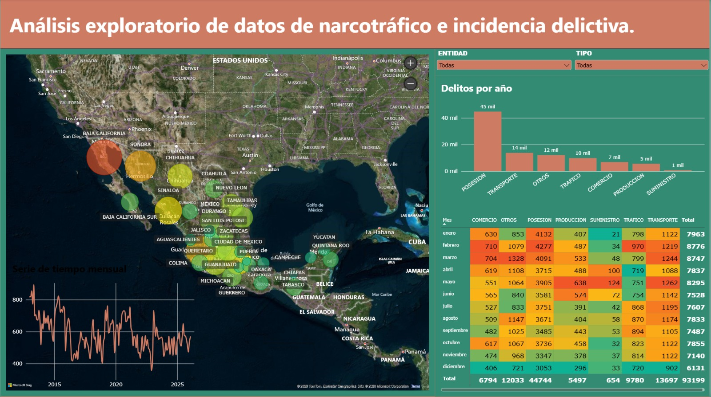

# Análisis de Incidencia Delictiva

El proyecto desarrollado durante mi estancia en la ENCiF consistió en la implementación de métodos estadísticos para ajustar modelos y realizar proyecciones de incidencias delictivas relacionadas con el narcotráfico.
Para el desarrollo del proyecto se trabajó con una base de datos que contenía el número de incidencias de cada delito, registradas mes a mes desde enero de 2012 hasta marzo de 2026.
En una primera etapa, se realizó una exploración y análisis inicial de los datos mediante el programa de Power BI. Posteriormente, se utilizaron diferentes métodos estadísticos para el ajuste y evaluación de los modelos, empleando el entorno de desarrollo RStudio.

---
## Fuentes de Datos

Los archivos CSV originales de este proyecto no se incluyen en el repositorio debido al límite de tamaño de GitHub, pero puedes obtenerlos de la siguiente manera:

- **Fuente principal:** Datos abiertos de incidencia delictiva del Gobierno de México
- **Enlace de descarga:** (https://www.gob.mx/sesnsp/acciones-y-programas/datos-abiertos-de-incidencia-delictiva)
- **Instrucción:** Descarga los archivos CSV correspondientes y colócalos dentro de la carpeta `data/` en la raíz de tu proyecto para que los scripts de R puedan leerlos correctamente.

---

## Vista Previa del Dashboard



---

## Estructura del Repositorio

```text
├── data/              # Instrucciones o archivos CSV procesados
├── src/               # Scripts de R para limpieza y modelado (.R, .Rmd)
├── reports/           # Reporte de Power BI (.pbix) y capturas
├── docs/              # Documentación técnica (ej. DAX_MEASURES.md)
├── .gitignore         # Archivos excluidos del control de versiones
└── README.md          # Documentación principal del proyecto
```

---

## Metodología y Flujo de Trabajo

1. **Procesamiento de Datos en R (`src/`):**
   - Lectura y estandarización de los archivos CSV originales.
   - Limpieza de datos (tratamiento de nulos, formateo de fechas y tipos de variables) usando `tidyverse` y `dplyr`.
   - Exportación de bases limpias / modelos (`.rds` o `.csv`).
   - Ajuste de modelos ARIMA y Prophet

2. **Modelado y Visualización en Power BI (`reports/`):**
   - Construcción del modelo de datos en esquema estrella.
   - Creación de medidas DAX para métricas acumuladas, tasas y variaciones.

---

## Hallazgos e Insights Clave

- **Insight 1:** [Baja California y Sonora son los estados con más delitos relacionados a narcotrpafico].
- **Insight 2:** [El suministro se hace en zonas mas pobladas].
- **Insight 3:** [Los modelos ARIMA se ajustan mejor a estas series].

---

## Cómo Ejecutar este Proyecto

### 1. Requisitos Previos
- **R / RStudio** (con paquetes: `tidyverse`, `prophet`, `here`, `tseries`, `plotly`, `forecast`)
- **Power BI Desktop**

### 2. Pasos para Clonar y Correr
1. Clonar el repositorio:
   ```bash
   git clone https://github.com/moinovoa/delitos_narcotrafico
   ```
2. Colocar los archivos CSV originales en la carpeta `data/`
3. Ejecutar los scripts de R ubicados en `src/` en orden secuencial.
4. Abrir el archivo `.pbix` en `reports/` con Power BI Desktop.